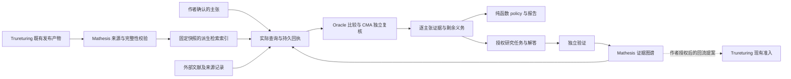

# Mathesis × Trureturing：能力提升分析与实施规划

2026-10-16，Asia/Singapore。状态：分析稿；未开始功能实施。

**建议把近期目标定为：让每篇审稿留下可追溯、可复核、可再次利用的数学比较结果，再把真正未完成的义务送入解题和形式化流程。** 优先形成“可靠审稿 → 检索已有知识 → 核实覆盖关系 → 明确剩余义务 → 验证解答 → 积累可复用知识”的闭环。模型、知识、验证、研究任务和学者参与分别提升，用一组可测量的结果判断进展。

用户提供的《Mathesis × Trureturing 集成设计：以 Trureturing 为判官与知识服务》方向成立：固定知识快照、逐主张比较、证据分级、上下游分责、历史不改写。落地顺序需要调整，证书、状态模型、既有接口、开放问题例外和产品授权边界需要补严。第一期应能消费现有上游产物；新上游 HTTP 服务不是开始下游工作的必要前提。

**一、此次分析的版本与证据边界**

独立 worktree：`/Users/lexa/Desktop/lexa/omega/mathesis-capability-plan-20261016`；分支：`codex/mathesis-capability-plan-20261016`。

| 对象 | 本次固定版本或读数 | 说明 |
| --- | --- | --- |
| Mathesis develop | `1e9b7f7fb3b981d3ca5079a0600bbe925eaa3455` | 分析期间新增作者资料提交，已快进纳入本 worktree |
| Mathesis PR #3 | `e3c4d0adedd3c641b2809694156b1baa35c43c7b` | OPEN；93 个文件，+4,658 / −348；查询时 12 个 SUCCESS、1 个 SKIPPED |
| Mathesis issue #4 | OPEN，最后更新 2026-10-15 15:13:36 UTC | 必查知识源与知识图谱的直接需求来源 |
| Mathesis 其他 PR | #2 已合并；#1 已关闭且未合并 | #2 提供作者 CMA BYOK；不把 #1 的 Wish-first 提案当成现行产品契约 |
| Trureturing dev | `b669ef36ee32627638ed55edc90152bf606a9df0` | 固定读取规则、接口与目录，不追着移动中的 dev 改写判断 |
| 上游环境 | Lean `v4.33.0`；Mathlib `db584cd6d46c92f209a44c0f1c829460d327499d` | 取自该版本 toolchain 与 manifest |
| 上游动态 | 最近更新的 100 条开放 issue/PR，以及最近列表中的 15 条已合并 PR | 用于发现接入风险；不是对全部上游工作逐项审计 |
| 上游冻结目录 | 8,649 个 `.lean.json` 模块状态文件 | 通过未截断的 Golden 子树枚举；不是定理数、有效登记数或数学覆盖率 |

证据截止窗口约为 2026-10-16 01:20 SGT。PR 检查状态是 GitHub 实际查询结果；数学能力、在线服务可用性没有因此被重新验证。本次没有运行 Lean、付费模型或生产审稿，也没有修改上游、发布外部 issue/PR。代码结论来自静态阅读，历史实测来自仓库已有验证记录。

**二、当前已经具备什么，真正缺什么**

| 能力 | 已有基础 | 当前短板 | 对路线的影响 |
| --- | --- | --- | --- |
| 审稿闭环 | 投稿、作者确认、Oracle、CMA audit、policy、advice、letter、作者回应和再审；版本与主张修订隔离 | 模型阅读质量及外部知识真实性仍主要靠判断；PR #3 尚未合并 | 接入现有轮次和恢复机制，不重造编排系统 |
| 正确性准入 | develop 的单条贡献要求正确性；PR #3 新增任一主结果 gap/error/not_checked 时阻止发表 | 新增门仍在 PR；不能仅因一个主结果有价值就忽略另一个主结果出错 | 准入修复是 P0 |
| 内容与价值分析 | PR #3 contract 3 有 baseline、searched、binding_analysis、delta、witness、utility、settlement | `searched: Vec<String>` 是模型字段，没有实际 Trureturing 查询回执 | #3 不是 #4 的交付；先补调用证据 |
| 形式验证 | 作者确认 Target digest；独立无凭据 verifier；多模块、反证、验证包 | 通用证明通过不证明已有知识覆盖，更不证明原文忠实性或新颖性 | 保留独立验证边界，另建覆盖关系证据 |
| 数学计算核查 | 可上传版本绑定的附件；模型能够报告计算 | 既有 live 验证明确区分模型计算与独立执行回执 | 增加受限、可重放的计算核验，优先补实际审稿失误 |
| 解题与参与 | Solve、Formalize、Report errors、配额捐赠、CLI/MCP、作者 CMA BYOK | 已有结果匹配、证明适配和失败原因尚未系统复用 | 先让现有解题路径拿到准确前置和剩余义务 |
| 身份与入口 | 新 develop 有作者 ORCID、机构、Google Scholar、网站资料 | ORCID 字段不等于 ORCID 认证；NyxID 仍是登录路径 | 先补可见贡献，再按实际转化问题增加身份认证 |
| 上游知识供给 | 冻结状态、Lean inspector、statement materials、Library、Problems、truth export/release 类型与验证器 | 尚未核实可直接接入的在线检索部署及兼容 publication 的实际定位地址 | 先做产物消费验证；缺部署不能被写成“所有接口均需新造” |

历史 live 证据比设计文档中的运行假设更丰富：`docs/REVIEW_LOOP_VALIDATION_2026-10-14.md` 记录了一篇私有论文的两轮真实 Oracle/CMA 审稿、自动信件和作者再审，发现并修复了“附件送给 Oracle，却未送给 CMA”的实际缺陷。这证明现有闭环有可复用基础，也说明提升能力必须检查输入是否真的送达，不能只改提示词。该记录不是当前生产可用性的证明，也不是 PR #3 新 contract 的 live 验收。

PR #3 的真实 Lean CI 已成功，Pages deploy 是被跳过的唯一检查。原设计“先拆成六个 PR”的建议不宜机械执行：它是一个已有绿灯证据的单提交候选。先评审正确性门、协议兼容、GridFS 迁移和上线恢复；若这些确实阻碍近期交付，再抽出最小正确性修复。新能力另开小 PR。展示站、共享 CI 调整不进入能力建设的关键路径。

**三、集成设计需要修订的关键判断**

| 设计中的假设或安排 | 核对后的修订 | 实际收益 |
| --- | --- | --- |
| T-1a 新造快照导出作为起点 | 先验证现有 `truth-release-publication.v1`、truth export v2、raw report v3 和 statement materials 能否满足需求 | 减少上游依赖，复用已经存在的身份和验证合同 |
| 只有新的 Trureturing HTTP 服务才能必查 | Mathesis 可在下游读取固定的已发布产物并建立可重建索引；查询由适配器实际执行并留回执 | #4 第一期可先推进；回执明确写 Mathesis issuer，不能冒称上游签发 |
| 仅 GID 与 statement_id 足够标识结果 | 区分模块状态摘要、frozen node id、声明 name key、声明 statement_id、type digest | 防止把整个模块身份误当成一条定理 |
| 冻结清单就是完整知识快照 | 清单需与报告、材料、环境、来源和成员集合一致；Library/atom 的证据资格另列 | 避免“有条目”被升级成“已证明” |
| snapshot = commit + Mathlib + toolchain + index | 另保存 publication/bundle digest、报告格式、模块实际 provenance、材料摘要；Mathesis 派生索引单独版本化 | 同 commit 的不同产物不会混同；索引重建不会伪装知识变化 |
| `incomplete` 与 `covered` 互斥 | 查询完整性与数学关系分开；可靠覆盖可与其他来源查询超时同时成立 | 保住正面证据，也保留查全范围的限制 |
| `refuted` 是覆盖状态之一 | 正确性/反驳独立；反证可以是形式结果，也可以是文献审查 | 已知为假的命题不会混入“覆盖/未覆盖”梯度 |
| 白名单 tactic + kernel 足以认证 bind-only | 需受限、可检查的推导语言和精确定义的规范化边界 | 防止普通证明被误标成已有知识绑定 |
| 已知结论有 witness 就可按新证明录用 | 现有 policy 要求 `known_by(...).is_none()`；§3.2 活路径规则又排除可直接绑定结论时的必要见证，需独立定义方法贡献与 admission basis | 避免文档、数学语义和代码三者冲突 |
| uncovered + bind_only 一律改判已知 | 保留具名开放问题结算的独立路线，分开已有逻辑蕴含与此前是否有公开结算 | 遵守上游 §3.2 的 open-problem-resolution 例外 |
| 窗口结束无挑战即可增强新颖性 | 必须记录实际参与、专业范围和有效核查；零参与窗口没有新增负证据 | 防止把等待时间当作研究成果 |
| 冻结只增不减，所以证书自动延续 | 旧证书在旧快照上保留；迁移后验证来源、依赖、工具链和证书协议，再追加新回执 | 上游存在迁移、重钉和不保留旧运行时格式的规则，不能假定新环境自动兼容 |
| 声明/atom/Library 数量代表覆盖密度 | 只能称“索引规模”；覆盖质量用分领域留出集召回率与适用范围衡量 | 数量不等于查全能力，也不能排除小领域空白 |
| covered 比例与 uncovered 比例是全局新颖性界 | 若保留汇总，只作固定主结果集合的证据计数，并分母列出 incomplete、争议及未评估项 | 不把有限样本比例解释成整篇论文或全球知识的新颖性概率 |
| 给每个见证新建 formalize 任务并以合入计分 | Mathesis 的 Formalized credit 仍走 attempt → independent verifier；上游合入另记来源贡献 | 遵守现有禁止 repository-assignment/PR 代替验证的契约 |
| 每轮直接查询最新版 | 在轮次第一次知识检索前持久化快照；恢复和追加查询使用同一快照 | 避免 Oracle 与 CMA 实际比较不同知识集合 |

证书设计的具体问题是：`exact`、`refine` 可接任意项，项中可嵌套计算、递归或新证明；Target 定义可隐藏大量数学工作；生成的 proof term 也会依赖 Lean 内核基础常量和 tactic 所需基础定理。仅检查 tactic 名、直接常量白名单和标准公理闭包，无法自动落实 §3.2 的“前置已提供全部原子事实”和“规范化没有建立新的实质命题”。

因此第二期应先规定有限推导语法，例如 `Use(statement_ref, substitutions)`、`DischargePremise(evidence_ref)`、`Project`、`Compose`、`Normalize(rule_set, budget)`，检查每个输入和中间义务，再生成并编译 Lean。是否允许 arithmetic decision procedure、允许的范围及复杂度，需要判官所有者确定。模型生成完整 Lean 源仍可作为普通证明候选，但不能仅凭通过编译获得 bind-only 标签。此处是规格分析，尚未实施或实测攻击。

还要区分“固定基线可推出”与“以前已经有人公开说出”。证书证明前者，文献出处和时间证据支撑后者。这正是简单绑定也可能结算外部具名开放问题的原因。不能把所有 certified binding 都自动写成“作者提交之前结论已为人知”。

“逃逸不可认证”也应缩小表述：对不受限的世界数学知识，不颁发“绝对新颖/永不可能被绑定”的证明；对预先固定的有限 arena、语言和成本预算，仍可能有严格的不可表达或不可能性结论。这样的有限结论不能外推为论文全球新颖性。

**四、上游接口的具体复用方案**

已核实的现行合同有四类。

1. `TruthReleasePublication`：`release_digest`、`bundle_ref`、`source_commit`、`source_tree`、`producer_commit`，且 `bundle_ref == release_digest`。定位器由部署提供，合同本身不提供 HTTP 地址。
2. `TruthReleaseManifest`：source snapshot、truth graph、raw Lean report、truth export、Blueprint index 等成员及哈希。代码明确说 producer 的 trust 字段是自述；解析通过与哈希相符不足以证明受保护分支和 required checks。下游按既有信任合同建立来源验证，不能自行省略。
3. `stratalint.truth-export.v2`：文件名仍可为 `truth-export.v1.json`，但实际 dialect 已为 v2；导出所有 Closed 节点，每个节点另有 `freeze_status`。**Closed 不等于 Frozen。** 若覆盖证书只允许冻结前置，必须按实际字段筛选。
4. `stratalint-raw-lean-report-v3` 及 `.sha256`、`.input.attestation`、`.provenance.json`、`.materials.zip`。传给消费者应保留完整组合；复用的模块保留原始 producer provenance，不能把整份报告说成当前实现重新评定。

第一个接入实验仅需要获得一个兼容的既有 publication/bundle 或完整规范报告包，验证其来源与完整性，然后选取几十条真实声明建立小索引。冻结文件只用于成员身份，不自行从正则解析 Lean 源生成“已认证”数学陈述。可读陈述从已有声明材料和相应来源投影取得；自然语言摘要另标为派生内容。

具体可用性仍有一个待验证点：本次读取的最近 100 个 GitHub Releases 中有生产 lean-cache、验证专用 lean-cache 和 Scribe resources，未识别到供 Mathesis 直接配置的 truth publication 地址。已抽查一个生产缓存 manifest，归档约 7.57 GB，包含构建产物，不适合每篇审稿重新下载；验证专用 `lean-cache-verify-*` 更不能自动当成正式发布。**代码合同已存在，但兼容产物定位与线上检索服务尚未完成端到端验证。** 这不是断言所有部署都不存在。

若现有产物可取：在 Mathesis 下游按原合同验证、归档、索引，查询时只读取固定索引；原始 bundle 的权威仍来自 Trureturing。若只能取得固定源码：允许建立有明确来源的检索候选索引，但保持 L1，不能将冻结元数据或源码解析升级成 L3；无法获得必要材料的范围保持 incomplete。若确实缺可消费产物：记录缺失对象、生产版本和接口，完成下游模型、导入器、故障处理、评估与界面；上游生产/发布由明确的另项任务负责。

先用 MongoDB 保存领域事实、关系和事件，GridFS 保存原始查询/来源材料；检索索引可丢弃重建。需要多前提关系时保存完整前提集合的超边 `{A, B} ⇒ C`，不能拆成 `A ⇒ C` 和 `B ⇒ C`。在可测量的性能瓶颈出现前，不引入新的图数据库或一组微服务。

**五、把“审稿实力”拆成可独立提升的六项能力**

| 能力 | 近期建设内容 | 衡量结果 |
| --- | --- | --- |
| 知道已经知道什么 | 结构化主张、别名/等价候选、类型特征、全文和文献检索融合 | 已知结果 Recall@k；每领域漏检率；候选中可定位来源比例 |
| 能说清覆盖为什么成立 | 参数替换、量词方向、全部假设、逻辑桥梁、多前提组合，CMA 对原始来源单独核查 | 错误蕴含率；遗漏假设负例的拒绝率；可复核 L2 关系数 |
| 能检查论证 | 保留正确性门；边界值、退化情况、反例搜索；先选一种计算证书做独立重放 | 实际错判/漏判；可重放发现；计算回执与模型意见不混淆 |
| 能产生值得做的后续任务 | 从四槽和未闭合义务生成精确目标，列已有供应者、缺失桥梁与成本边界 | 任务被采用率；完成率；每个验证完成结果的成本和时间 |
| 能完成并验证解答 | 现有 CMA/本地贡献者尝试 → 独立 verifier；匹配已有证明、适配 Target | verified target 数、复用成功率、失败原因分布、原文忠实性通过率 |
| 能从每次工作积累 | 关系与来源去重、错误修正、版本失效、授权回流、贡献署名 | 后续审稿实际复用的关系数；避免的重复工作；回流后再次被使用的成果 |

下一步算法升级优先从已有错误样例出发。比如附件传输曾真实失败，就先保证每条核心结论用到的材料确实进入审稿输入；一旦检索找到强候选，再安排参数对应核查和短证书尝试；候选缺少必要假设时，优先搜索反例或缺失桥梁。预算按这类可执行义务分配。

每个研究任务至少具备：原文定位、完整量词与假设、相关结果及来源、要证明的精确桥梁或要寻找的反例、证据/工具链要求、运行预算、停止条件、结果回写位置。停止条件包括已有供应者完全覆盖、发现反例、输入不忠实、预算耗尽且没有缩小义务。重试必须带来新输入或可验证的新进展。

这里的“积累”首先是经过核查的检索材料、关系、证书和失败经验，不是自动训练模型。模型更换或增加模型轮数应由同一留出集上的对照结果支持。

**六、Mathesis 数据与 policy 的建议模型**

新 `ClaimAssessment` 应引用现有主张身份，分别保存以下字段，而不是把全部语义塞进一个 `ClaimCoverage.status`。

| 维度 | 建议值或内容 | 要求 |
| --- | --- | --- |
| identity | submission、source version/digest、claims_revision、claim_id、round、可选 target digest | 私有稿与录用前没有 WP 编号，不能用 record 作为唯一键 |
| query | 每个来源的 complete/partial/unavailable/timeout/invalid_request；scope、截断、receipt refs | complete 只指声明的检索计划执行完，不表示全部数学知识已查完 |
| relation | unknown、candidate、covered.verified、covered.certified；挑战与争议另存 | 未命中由 query 结果推出 bounded no-match 视图，不能视为证明 |
| correctness | correct/gap/error/not_checked；反证证据引用 | 与覆盖、价值完全独立 |
| proof | content/bind_only/undetermined；可为 intermediate 或 conclusion 的 witness | 猜想没有现成证明，应标不适用，不能制造 witness |
| value/admission | utility、new_result/new_proof/open_problem_settlement/open_conjecture 等候选类别 | 新类别未获规则确认前不能自动启用 |
| evidence | L1/L2/L3、issuer、来源、论证、目标/快照/工具链/摘要、有效范围、失效事件 | 级别对某项命题成立，不是给整条论文统一贴 L3 |

建议保存的领域对象：`KnowledgeSnapshotRef`、`ClaimQuery`、`QueryReceipt`、`CoverageRelation`、`EvidenceRecord`、`AssessmentEvent`、`ResearchObligation`。其中 L2 关系记录参数与假设、Oracle 提案和独立 CMA 检查的证据引用；两个模型都说“对”不等于来源真实。L3 须指向受认可的检查器回执和精确 Target；没有 Target 的自然语言主张最高保留审稿证据等级。

查询回执应包括请求与结果哈希、实际请求时间、快照、请求 scope、完成/缺失 scope、候选稳定身份、截断/分页信息、issuer 和存储引用。哈希绑定字节，不自行证明签发者；若使用远端服务，另验证响应来源。重试幂等身份绑定 submission/version/claims_revision/claim/snapshot/query-plan，用户或模型不能靠改自由文本伪造一次查询已完成。

同一轮先持久化快照与查询身份，再发外部请求。worker 重启复用任务与快照；模型输出只允许引用系统已存的 receipt id。CMA 的追加查询也通过同一有记录入口。租约丢失、旧 claims_revision 的迟到结果、重复交付和查询后正文修改都由现有 revision/lease 思路拒绝或归档为旧事件。

新接口继续满足现有层约束：Layer 2 定义领域对象、ports 与规则；Layer 3 提供不依赖 Layer 2 的 transport/wire；binary composition 做映射、I/O 和工作编排；Layer 1 投影公开 API。若新增 `layer3-knowledge`，不能让它反向依赖 Layer 2。API 字段、OpenAPI、SDK/MCP、web 类型和基础设施配置同步演进。

建议 policy 决策顺序：

1. 检查投稿目的、作者确认、版本与权限。`review_only` 继续只给私有审查意见。
2. 先执行主结果正确性门；错误或实质缺口不能靠新颖性抵消。
3. 新结果/开放猜想路线要求相关主结果的必查计划完成且证据足够；暂时故障显示可重试 pending，不把故障当作数学拒稿。允许形成带限制的报告。
4. 对可靠覆盖逐条分类：已有结论的普通绑定、候选新证明、具名开放问题结算分别处理；其余已知主结果不自动否定另一条真正新增主结果。
5. utility 保持 PR #3 的分类纪律；一般纯数学定理无需捏造应用。挑战结束不替代正确性、价值或文献比对。
6. 历史决策使用当时协议和输入；后续证据追加更正、争议或撤销事件，不修改旧报告。认证存在的历史事实与该证据目前是否有效分别显示。

“新证明”是独立的产品决定：需要已知结论出处、正确证明、真实方法增量及价值说明。若已知结论本身已在基线中，直接引用就能得到结论，不能再按上游 §3.2(iv) 宣称某个新引理是得到该结论不可绕过的逃逸见证。可将方法本身产生的更强结论、构造性信息、算法或估计列为独立主张评估；纯证明方法贡献需要独立标准，不能靠临时删去基线中的已知定理制造逃逸。局部证明链里不可绕过的引理，也不证明该方法未被文献采用。开放问题结算还应分别记录先前逻辑可导性、外部具名问题的公开状态、原投稿时间和解决时间；将今日包含解答的快照用于历史论文时，不能反推出论文当年无新意。

第一期继续使用新轮次的固定 contract，预计在 contract 3 基础上增加新版本；旧任务的提示词字节、provider identity 和历史 replay 不变。不要给老轮次补造查询回执。已有 Target 通常在录用后产生，因此 L3 覆盖是可选升级，不能成为所有首轮审稿的前置；若未来引入录用前 Target，单独设计作者确认流程。

**七、按验收门推进的工作队列**

以下编号是本分析的规划编号，不是已经创建的 GitHub issue/PR。只规划 Mathesis 可承担的改动；上游需要新判官、部署或发布时另列依赖。阶段按实际验收推进，不承诺尚未测量的完成日期。

| 顺序 | 规划项 | 具体交付 | 完成门 | 依赖 |
| --- | --- | --- | --- | --- |
| P0-A | #3 准入与兼容评审 | 确认正确性门、新轮次 method、旧任务 replay、GridFS 读写兼容与恢复；在最新 develop 上处理实际差异 | 通过既有相关检查；迁移与回滚有明确边界；新 contract 做真实小样本验证 | 现有 PR #3 |
| P0-B | 固定评估集与现状读数 | 样例来源、标签证据、基线输出、留出分组、成本与限制 | 调优前固定样本与评分规则；留出集不用于写提示词 | 可与 P0-A 独立准备 |
| P1-A | 消费现有产物的接入实验 | 选一个 publication/report 包；来源与材料验证；声明身份映射；小规模真实查询 | 可重复取得同一原始字节；精确定位定理与冻结资格；失败原因明确 | 兼容产物可定位 |
| P1-B | 下游覆盖契约和存储 | `docs/COVERAGE_CONTRACT.md`；分维模型、追加事件、复合身份、权限 | partial + covered 并存；版本切换与重试不丢历史；旧报告无伪回执 | P0-B 的反例与 P1-A 合同读数 |
| P1-C | 实际查询与审稿接入 | Layer 3 适配器、固定索引、durable 查询、Oracle/CMA 共用快照与证据 | 新轮次有系统调用证据；断线恢复原查询；无记录不能标必查完成 | P1-A、P1-B、#3 基础 |
| P1-D | policy、报告与私有作者视图 | 知识限制、逐主张关系、证据链接、缺失假设、四槽与待办；JSON/Markdown 一致 | incomplete 不产生充分新颖性；review_only 不出版；私有来源不可越权读取 | P1-C |
| P1-E | 端到端与质量比较 | 真实论文小批量审稿、故障恢复、基线对照、分领域召回和错误蕴含 | #4 的必查、可追溯、失败语义、权限与评估条目均有证据 | P1-D |
| P2-A | 剩余义务与解题复用 | 按假设/桥梁生成任务；向已有 attempt 路径提供相关前置、精确目标和预算 | 一项真实义务从报告进入授权任务，经独立 verifier 得到结果，并能回到原主张 | P1-E；作者与目标授权 |
| P2-B | 计算证据重放 | 选择一类实际常用的有限证书；受限输入、资源预算、验证器回执 | 有已知阳性与破坏性阴性；明确只证明该有限计算结论 | P0-B 的实际错误样例 |
| P2-C | 覆盖证书消费 | 接入上游认可的有限证书协议与检查器；无能力时保持 L2 | 至少一条真实 L2 → L3；错误目标/依赖/操作/工具链负例拒绝 | 上游明确提供并授权的能力；不是第一期前置 |
| P3-A | 学者绑定贡献与挑战 | L2 绑定提交、申诉、可见贡献、独立核查、撤销；MCP/CLI 对等入口 | 至少一条外部贡献成立；同绑定只计一次；授权撤回关闭新访问 | P1-E；可公开的证据摘要 |
| P3-B | 授权回流和再次消费 | 先生成带来源、许可、上下游身份的提案包，经现有准入回流 | 上游真实接受/冻结后，下一个下游快照能重新找到该结果；两边 credit 各有自己的凭据 | P2/P3 成果；明确发布授权 |

按这张表，第一批应具体准备 **P0-B 评估合同、P1-A 产物消费实验、P1-B 分维数据契约**；同时推动 #3 的准入与兼容评审。没有必要先搭 `/v1/proposals`、统一微服务部署、悬赏排行榜、ORCID peer-review 或完整论文自动形式化。

P1-E 的纵向验收案例应包含：同一已知定理换名或换参数后投稿 → 系统查询固定 Trureturing 快照 → 把命中原陈述与来源送到 Oracle/CMA → CMA 指出参数与假设匹配 → 报告显示有证据的覆盖。再删掉一个必要假设，必须保留未闭合义务，不能沿用前一份覆盖判词；模拟一处检索超时，正确显示未完成并在恢复后继续同一版本。

**八、评估安排与衡量标准**

建议首批 120 个主张级案例，作为工程规模提案，尚未完成采样或测量。分六组各约 20 个，按论文/定理家族分组取约 80 个开发样本、40 个留出样本，确保同一家族的改名与变形不跨集合泄漏。先从数论/递推、组合图论、量子/矩阵不等式三个有实际材料的方向开始；若某领域没有足够可信标签，缩小范围并披露，不以弱标签补足数量。

| 组别 | 样例与标签依据 | 重点 |
| --- | --- | --- |
| A | 已在固定快照真实合入、已验证且能对应原问题的结算 | 找到精确解答和适用假设；不能仅凭 PR 标题或 open PR 身份入阳性集 |
| B | 已知定理特例、改名、等价表达、参数替换 | 已知内容召回；不是仅靠术语重合 |
| C | 多前提组合、遗漏假设、方向反转、量词/退化情况变化 | 阻止错误蕴含；保留全部前提和未证桥梁 |
| D | 已知结论的新方法，以及由简单绑定结算的具名开放问题 | 分开结论、证明和结算依据 |
| E | 有专家核对依据的候选新结果与覆盖稀疏案例 | 使用“固定范围未找到覆盖”标签；专家也不提供全世界未曾出现的真值 |
| F | 查询故障、损坏产物、快照更新、来源撤销、自我引用、版本竞态 | 完整性与恢复；未完成不能伪装为新颖 |

上游近期开放 PR #17469、#17453、#17418 等可作为未来样例线索，但在固定快照里未合入/未取得相应证据前，不计入 A 类已解决真值。理论 PR 合并也不自动等于 Lean 证明。#17403、#17438 展示数学与 Reg 登记可以处于不同状态；评估标签必须保留这种差异。#17122 提供真实的报告格式/缓存失配案例，适合验证下游拒绝无效包和保留旧有效快照。

对照组依次是：固定版本的 contract 3；加入真实检索回执；加入结构化假设/参数对应与独立来源核查；再加入证书尝试或计算重放。控制模型、快照、预算和样例，记录每一步的新增收益。调优目标用开发集基线确定，打开留出集前固定阈值；不能看过留出结果再改目标。

指标分开报告：Recall@k、已知漏检率、错误蕴含率、目标忠实性失败率、incomplete 原因分布、每领域有效覆盖、真实可重放缺陷数、每篇/每个验证成果的延迟与成本、后续复用率。对“正确判 unknown”保留得分，不能为了降低 incomplete 逼模型猜。

协议不变量从第一天固定：伪造/不存在的回执不能生效；缺失假设的负例不能判 covered；跨版本证据不能自动应用；私有数据不能进入公开索引；历史结果不能被改写；损坏 bundle 不能成为可信快照。经验性质量指标先测后定。L3 的任何已确认错误蕴含都是缺陷，样本中零错误也不等于已经证明实现无漏洞。

**九、知识、解题与学术参与如何形成正反馈**

审稿新增的高价值资产是“这条具体主张在这些假设下被什么结果覆盖，尚差什么”，而非一整篇不可复用的评价文章。可跨稿复用的 L2 关系要带条件和许可；私有稿中得到的内容不能因为被摘要或向量化就进入共享索引。相同投稿及其派生结果不能进入本轮外部权威基线支持自身，内部依赖和外部既有知识分开存。

对作者，先让报告给出三类可执行结果：可直接引用的已有定理、必须修复的具体问题、最值得证明的剩余桥梁。对学者，最早的参与入口是“指出已有结果”并提交来源与参数对应；系统完成来源核查和独立复核后，再记绑定发现 credit。对贡献者，Lean 尝试继续走现有 Target 和独立 verifier，充分利用已找到的定理，减少重证。

公开证据摘要是新权限面。accepted/public 不等于作者同意公开全部审稿，也不等于 opt-in contributions 或允许回流。分别保存：论文可见性、贡献者访问、可公开的覆盖摘要、向公共知识库回流许可。查询原文、embeddings、缓存、失败重试消息与日志都应遵守同一私密性边界。撤回授权阻止新的公开传输；已经按许可发布的历史如何保留，需在授权文本中说明。

回流沿用现有准入：已有文献进入 Library；未解决问题形成精确预登记建议；原创证明交付走上游已有内容/形式化规则；错误按现有勘误处理。只有上游实际接受的事件才显示“已回流/已冻结”。Mathesis Formalized、上游贡献、绑定发现、证书升级分别记账，避免一次成果在同一指标里重复累计。

**十、需要明确的决定，以及建议默认项**

| 决定 | 建议 | 是否阻碍第一期 |
| --- | --- | --- |
| 首期知识提供方式 | 优先下游消费已发布固定产物；有真实可用的上游检索服务再换 transport | 不阻碍契约与评估；真实接入需一个兼容产物 |
| L2 的 policy 效力 | 来源可定位、完整参数/假设对应且经独立复核的 L2，可阻止按新结果录用；证据不足保持 candidate/争议 | 应在 policy 实施前固定 |
| 新证明是否为录用类别 | 单独增加 NewProof 类别和质量要求；首期可以先展示，不默认放开录用 | 不阻碍必查 |
| WP 是否符合上游第一档来源 | 由上游内容规则所有者裁决；已有正式文献来源的问题可先走原路径 | 不阻碍第一期；影响 WP 专属回流 |
| bind-only 的规范化范围 | 由上游判官所有者提供有限协议、边界与变异验收；普通 verifier 不代判 | 只阻碍 L3 覆盖认证 |
| 挑战窗口 | 先做受邀贡献的小规模试验，记录参与和有效核查；窗口只是流程，不承诺新颖性升级 | 不阻碍必查与 L2 |
| 回流许可证 | 独立、默认不勾；按上游现有许可证与作者权利设计，不由本分析擅选 | 只阻碍公开回流 |
| ORCID 登录/绑定 | 复用已有资料字段；有贡献转化数据后决定是否加验证身份 | 不阻碍数学能力提升 |

最近可审阅的实施目标应是：**用真实上游产物完成一个版本绑定的知识查询和来源比对，并用正例、遗漏假设负例及中断恢复案例证明行为。** 它直接回答 issue #4，同时为更强的审稿、解题和回流建立可复用基础。

**证据索引**

- [Mathesis issue #4](https://github.com/the-omega-institute/mathesis/issues/4)：必查、真实回执、知识图谱、回流与评估要求。
- [Mathesis PR #3](https://github.com/the-omega-institute/mathesis/pull/3)：当前开放候选与检查；[固定版本方法论文档](https://github.com/the-omega-institute/mathesis/blob/e3c4d0adedd3c641b2809694156b1baa35c43c7b/docs/REVIEW_METHODOLOGY.md)。
- [PR #3 policy](https://github.com/the-omega-institute/mathesis/blob/e3c4d0adedd3c641b2809694156b1baa35c43c7b/api/crates/layer2-core/src/policy.rs)、[methodology 模型](https://github.com/the-omega-institute/mathesis/blob/e3c4d0adedd3c641b2809694156b1baa35c43c7b/api/crates/layer2-core/src/model/methodology.rs)、[轮次入库检查](https://github.com/the-omega-institute/mathesis/blob/e3c4d0adedd3c641b2809694156b1baa35c43c7b/api/crates/layer2-core/src/app/referee.rs)。
- [Mathesis 当前契约](https://github.com/the-omega-institute/mathesis/blob/1e9b7f7fb3b981d3ca5079a0600bbe925eaa3455/CLAUDE.md)、[真实审稿闭环记录](https://github.com/the-omega-institute/mathesis/blob/1e9b7f7fb3b981d3ca5079a0600bbe925eaa3455/docs/REVIEW_LOOP_VALIDATION_2026-10-14.md)、[研究服务](https://github.com/the-omega-institute/mathesis/blob/1e9b7f7fb3b981d3ca5079a0600bbe925eaa3455/docs/RESEARCH_SERVICES.md)。
- [作者 CMA BYOK PR #2](https://github.com/the-omega-institute/mathesis/pull/2)、[已关闭的 Wish-first PR #1](https://github.com/the-omega-institute/mathesis/pull/1)。
- [Trureturing 固定版本规则](https://github.com/the-omega-institute/trureturing/blob/b669ef36ee32627638ed55edc90152bf606a9df0/CLAUDE.md)：§3.2 判形与开放问题结算，§3.9 登记，§4.2 单版本规则，§10.4 报告与来源。
- [Lean inspector 接口](https://github.com/the-omega-institute/trureturing/blob/b669ef36ee32627638ed55edc90152bf606a9df0/tools/lean-inspector/README.md)：报告、材料、sidecar、来源及缓存边界。
- [TruthReleasePublication](https://github.com/the-omega-institute/trureturing/blob/b669ef36ee32627638ed55edc90152bf606a9df0/tools/Trureturing.Truth/Release/TruthReleasePublication.cs)、[publication 验证](https://github.com/the-omega-institute/trureturing/blob/b669ef36ee32627638ed55edc90152bf606a9df0/tools/Trureturing.Truth/Release/TruthReleasePublicationVerification.cs)、[manifest 与信任边界](https://github.com/the-omega-institute/trureturing/blob/b669ef36ee32627638ed55edc90152bf606a9df0/tools/Trureturing.Truth/Release/TruthReleaseManifest.cs)。
- [truth export v2 schema](https://github.com/the-omega-institute/trureturing/blob/b669ef36ee32627638ed55edc90152bf606a9df0/tools/Trureturing.Truth/TruthExport/TruthExportSchema.cs)、[导出入口与冻结一致性](https://github.com/the-omega-institute/trureturing/blob/b669ef36ee32627638ed55edc90152bf606a9df0/tools/StrataLint.Cli/Commands/TruthExportCommand.cs)。
- [StarExtrema 登记/报告问题 #17403](https://github.com/the-omega-institute/trureturing/issues/17403)、[Cayley 结果登记未完成 #17438](https://github.com/the-omega-institute/trureturing/issues/17438)、[报告格式失配 #17122](https://github.com/the-omega-institute/trureturing/issues/17122)。
- 同目录 [证据摘要 JSON](MATHESIS_CAPABILITY_EVIDENCE_2026-10-16.json)：固定提交、GitHub 状态、目录计数、设计原文摘要及本次观测边界。完整原始 API 读数保留在 `/private/tmp/mathesis-capability-evidence-20261016`。
