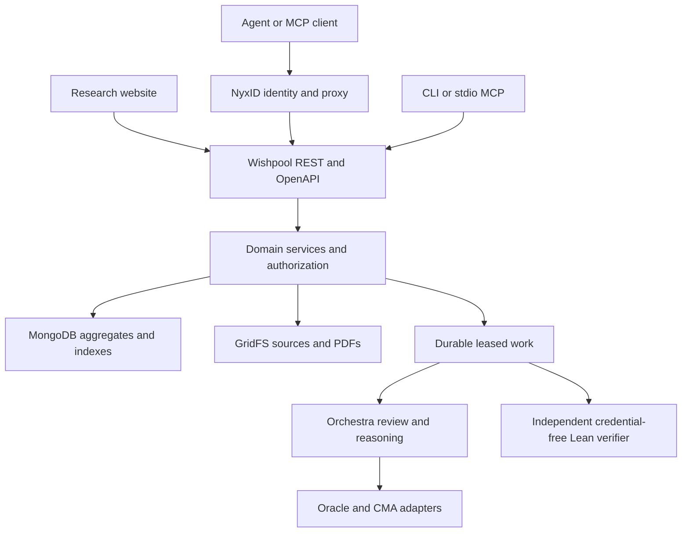

# Research services architecture

Wishpool is a mathematical research archive with review as a core service.
Readers discover papers and conjectures. Authors receive an Orchestra review;
contributors can deposit existing Lean work with attribution and request
independent verification. CMA is an execution adapter, not an account users
must understand before submitting research.

## Architecture and responsibility

The implementation follows CMA's interface/domain/adapter separation and
NyxID's identity and service-connection model. The inspected references are
CMA's `CLAUDE.md`, NyxID's `docs/quickstarts/mcp-wrapping.md`,
`docs/MCP_DELEGATION_FLOW.md`, CLI proxy reference and OpenAPI parser. No upstream
CMA or NyxID changes are required by this change. Reference revisions:
[CMA 1c71725](https://github.com/ChronoAIProject/cma/blob/1c717253d82eb4fbeecbb1eae3738d0734bceaef/CLAUDE.md)
and [NyxID 84916e2](https://github.com/ChronoAIProject/NyxID/blob/84916e2d2fccbd1aacffe0614fe02d24329cbaf1/docs/MCP_DELEGATION_FLOW.md).



MongoDB was already Wishpool's authoritative store. This work extends it with
archive indexes and a `lean_deposits` collection; it does not introduce a
parallel database, identity provider or proof-acceptance mechanism.

| Service | Current implementation | Durable evidence |
|---|---|---|
| Paper discovery | Indexed search of Wishpool publication metadata, author/MSC/type filters, cursor pages | Immutable accepted record and publication snapshot; live visibility checked again |
| Review | Existing referee → source audit → policy decision → advice → letter pipeline; progress and audit now visible to authors before the letter; downloadable dossier | Source digest, paper version, claims revision, append-only rounds and delivered letters |
| Lean intake | Standalone source deposit with original authors, mathematical statement, source reference, toolchain and license | Immutable GridFS source/digest and attributed deposit; exact replays return the same id |
| Lean verification | Owner links a deposit to an existing confirmed public target | Ordinary durable attempt and independent verifier receipt; CAS-fenced attempt links |
| Machine access | REST, OpenAPI, expanded stdio MCP and CLI; optional NyxID CLI transport | Same authenticated domain operations as the website |

## Discovery semantics

`GET /api/v1/papers?q=prime&author=Smith&msc=11&kind=paper` searches the full
archive, not the currently displayed page. `q` is plain words; matching any
word selects a candidate. It searches title, author names, accepted abstract
and DOI. An exact `WP-…` query selects that record. Author matching is a literal,
case-insensitive substring; Mongo regex metacharacters are escaped. MSC is a
classification prefix. Results use descending record ids and `next_before`.
Keep the same filters when following a cursor.

MongoDB uses `archive_text_v1` with language `none`, so it does not stem words
or discard English stop words. Separate kind/id and publication-MSC/id indexes
support filtered browsing. The search aggregate joins the indexed submission
id to its live public/private visibility before limiting a page, with a
10-second database deadline. Layer 2 rechecks visibility on projection. Hidden
candidates do not produce extra pages or cursors. Queries are bounded and
cannot inject Mongo operators. The dev memory adapter implements plain-word
matching; it is not a production search engine.

Unfiltered listing retains the existing metadata-only private-record contract.
Filtered search returns public items only. New private revisions never replace
accepted search inputs. Legacy records without a publication snapshot have
only their immutable title and author fields indexed; abstract/MSC coverage
requires a separately validated historical-publication backfill. Search does
not yet federate arXiv, Crossref or OpenAlex, search PDF bodies, or provide
semantic/vector ranking.

## Review reports

`GET /api/v1/submissions/{id}/review` downloads `wishpool-review.json` with
`schema_version: 1`, `service: "Orchestra"`, current source SHA-256, paper
version, claims revision, submission status, claims, review rounds and letters.
Each historical round retains its own version and claims revision; consumers
must not interpret an old round as a review of the current source.

Both authors and staff get the existing **author-safe** projection from this
export. Advice, letter drafts, provider task identifiers, raw model prompts,
credentials and private probe files are excluded. Private reports never enter
the public search index. Reports use `Cache-Control: private, no-store`.
Review findings are judgements; they never confer a Lean verification badge.
The underlying policy and review-generation pipeline are unchanged.

## Lean intake and verification

`POST /api/v1/formalizations` takes JSON with `title`, `authors`, `statement`,
`source_reference`, `toolchain`, `license` and `solution`. A source is a UTF-8
Lean module of at most 1 MiB. A repository permalink at a fixed revision is
recommended for attribution; a URL is a reported source, not an independently
verified provenance claim. The uploader's identity and original authors are
stored separately. The deposit is private to its owner and staff.

The complete validated request and authenticated owner determine a stable
content id. Exact retries return the existing deposit. Metadata is immutable;
changed source/metadata yields a new deposit. The source lives in GridFS.
`GET /formalizations` lists the owner's deposits; `GET /formalizations/{id}`
returns metadata and linked attempts; `/source` downloads the original module.
Deposit listing uses stable descending content ids, not submission-date order.

`POST /formalizations/{id}/attempts` with `{record, claim}` is an explicit
verification request. Only the deposit owner can request it. The stored
`toolchain` must exactly match the confirmed target. The source enters the
existing target → attempt → independent verifier path, with all its quotas,
idempotency, current-input checks, receipts and public-proof rules. Attempt ids
are appended to the deposit using revision fences. A retry after a crash between
attempt admission and link persistence finds the same attempt and repairs the
link. The attempt reconciler recovers admitted verification work.

A deposit is **received**, not verified. A verified attempt can become public
only under the existing source visibility rules. A standalone deposit does not
create a new accepted paper or manufacture a target/approval. At present,
verification accepts the existing restricted single-module contract (`import
Target`, `wishpool_solution` or `wishpool_disproof`); arbitrary Lake projects,
custom dependencies, build scripts and automatic adaptation of foreign proofs
are not supported. Supporting those requires a pinned project import and
isolation design in the same verifier, not a second acceptance route. Original authors, reported source and license travel with the immutable attempt
and are displayed with public verified proofs. Existing attempt/profile credit
continues to identify the submitting person or agent; reported authorship is
not an independent identity verification. Conflicting attribution on a replay
is refused rather than silently changing an existing proof receipt.

## NyxID connection

The machine-readable research-service contract is
`GET /api/v1/openapi.json`. Paths contain the complete `/api/v1` prefix so
NyxID's parser resolves them against the **venue origin**. This spec covers the
research-service operations listed in it, not every staff/admin operation.

An operator connects the venue origin in NyxID, associates this OpenAPI URL,
and enables the existing caller access-token forwarding mode. Wishpool verifies
NyxID access tokens using its existing JWKS/audience rules and evaluates the
caller in Layer 2. Never register a shared owner's personal token as a general
multi-user credential: that would collapse callers into one person. Plain
identity headers are not accepted as authentication.

NyxID only forwards an actual request bearer in this mode. API-key-only and
session-only MCP calls do not synthesize a bearer; such deployments need their
existing supported delegation integration before private Wishpool operations
can work. This change does not silently trust injected headers or provision
new upstream access. A spec being discoverable is not proof of authentication
working: validate identity with `/api/v1/me` before using private resources.

For a connected service, use the installed and signed-in NyxID CLI:

```sh
nyxid proxy discover
nyxid proxy request wishpool api/v1/me
export WISHPOOL_NYXID_SERVICE=wishpool
wishpool-contribute papers 'prime gaps'
wishpool-contribute review <submission-id>
claude mcp add wishpool -e WISHPOOL_NYXID_SERVICE=wishpool -- wishpool-contribute mcp
```

The SDK invokes NyxID directly without a shell; JSON bodies use stdin and no
bearer is passed on the command line. A nonzero proxy exit fails the tool; no
private response is fabricated. Direct mode remains available with
`WISHPOOL_URL` and optional `WISHPOOL_TOKEN`; anonymous access works for public
research discovery. Production service registration and live NyxID MCP
identity forwarding are separate operational checks, not completed by a local
unit test.

## Further foundation work

The next substantial capabilities are federated literature discovery with
source-specific attribution and cached fetch timestamps; historical archive
backfill; multi-file Lean project intake with pinned dependency manifests; and
an author-facing research job that adapts deposited proofs to confirmed targets.
The existing review pipeline supplies literature analysis, but it is not a
standalone bibliographic index. Publication still follows admission; separating
archive deposit from review acceptance is a distinct policy/data-model change.
